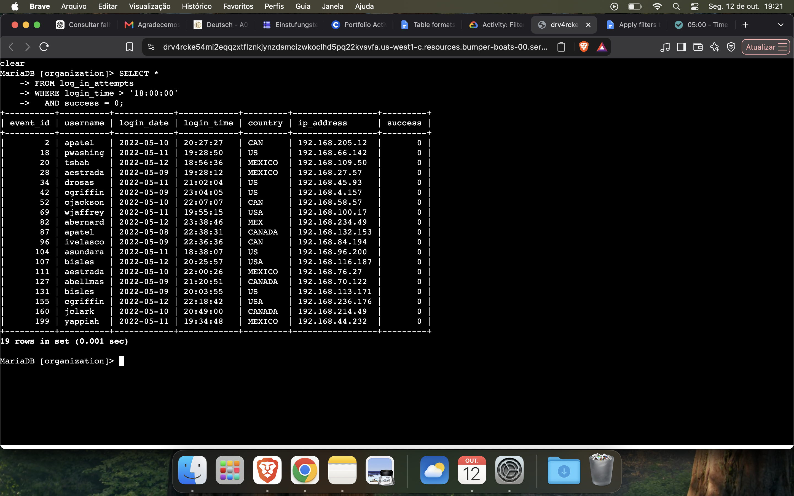
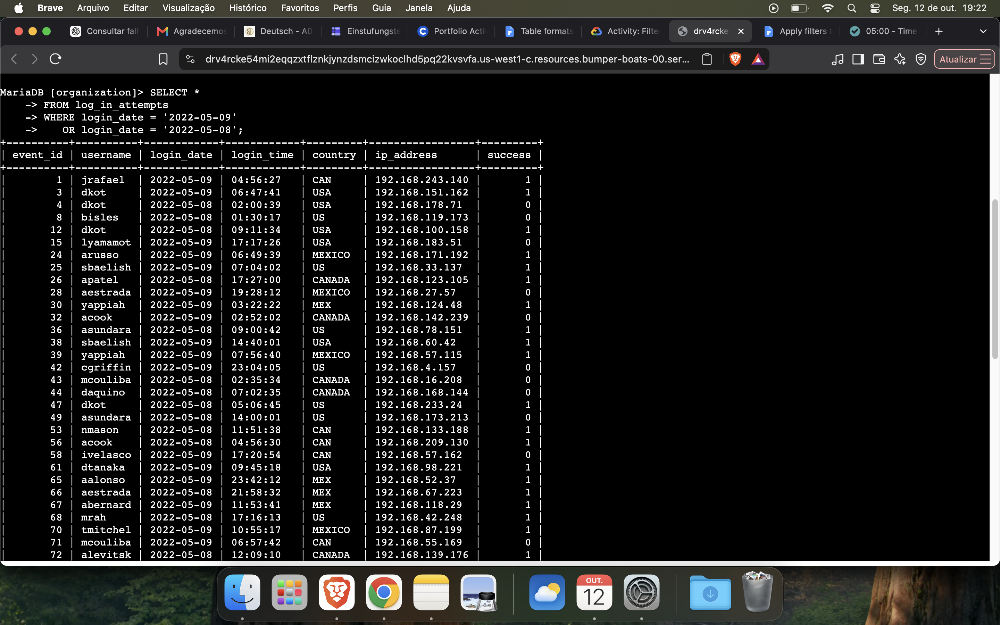
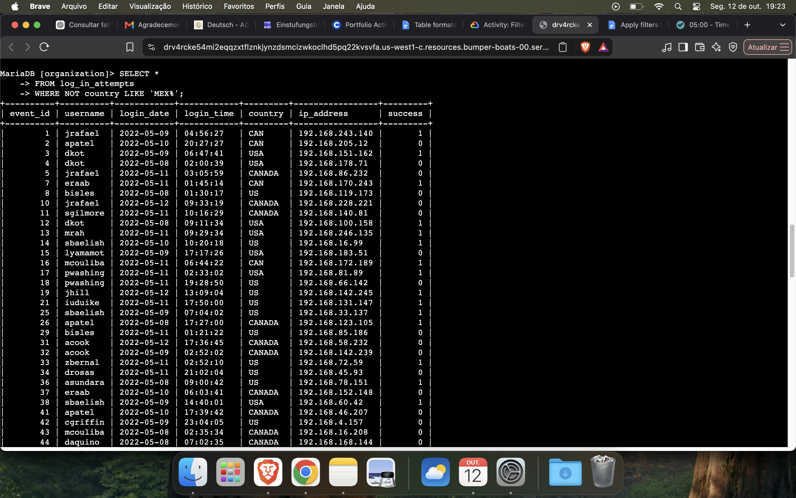
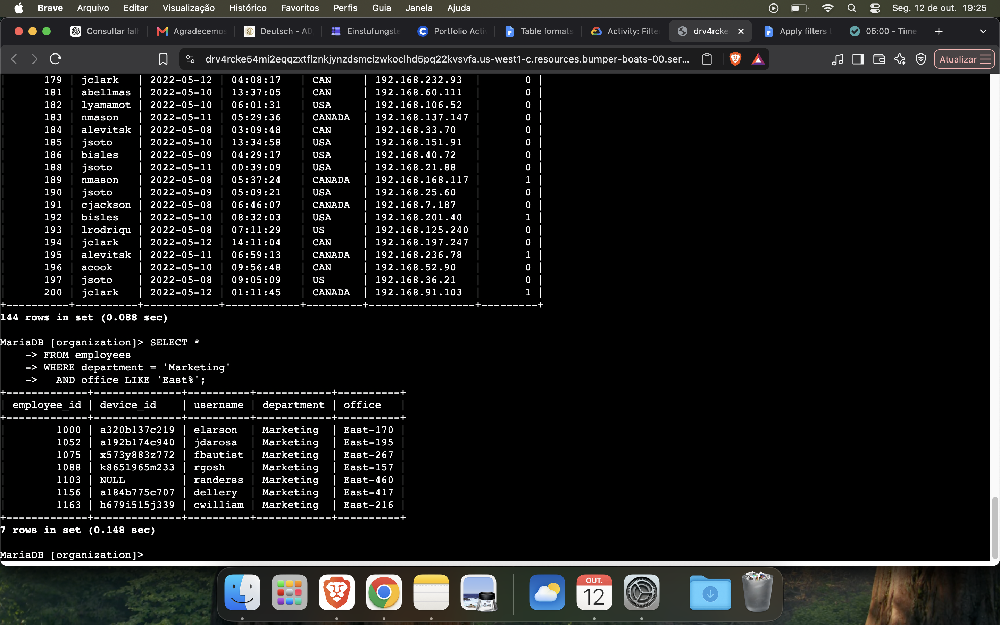
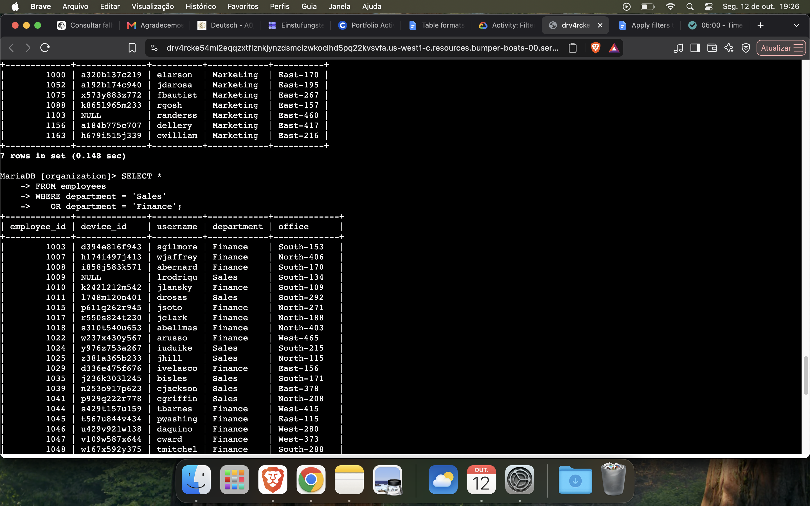
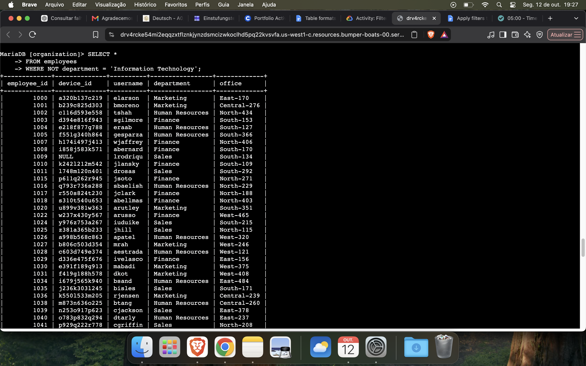

# SQL Filters for Security Investigations

## Project Overview

This project demonstrates how SQL filters can be used to investigate suspicious login activity and identify employee machines that require security updates.

The project uses the `log_in_attempts` and `employees` tables to practice filtering data with `WHERE`, `AND`, `OR`, `NOT`, and `LIKE`.

## Tools and Skills

* SQL
* Data filtering and retrieval
* Security incident investigation
* Login activity analysis
* Employee data analysis

## 1. Retrieve After-Hours Failed Login Attempts

**Objective:** Identify failed login attempts after 6 p.m.

```sql
SELECT *
FROM log_in_attempts
WHERE login_time > '18:00:00'
AND success = 0;
```



## 2. Retrieve Login Attempts on Specific Dates

**Objective:** Review login attempts from May 8 and May 9, 2022.

```sql
SELECT *
FROM log_in_attempts
WHERE login_date = '2022-05-09'
OR login_date = '2022-05-08';
```



## 3. Retrieve Login Attempts Outside Mexico

**Objective:** Identify login attempts from countries other than Mexico.

```sql
SELECT *
FROM log_in_attempts
WHERE NOT country LIKE 'MEX%';
```



## 4. Retrieve Employees in Marketing

**Objective:** Identify Marketing employees located in the East building.

```sql
SELECT *
FROM employees
WHERE department = 'Marketing'
AND office LIKE 'East%';
```



## 5. Retrieve Employees in Finance or Sales

**Objective:** Identify employees in the Finance or Sales departments.

```sql
SELECT *
FROM employees
WHERE department = 'Sales'
OR department = 'Finance';
```



## 6. Retrieve All Employees Not in IT

**Objective:** Identify employees outside the Information Technology department.

```sql
SELECT *
FROM employees
WHERE NOT department = 'Information Technology';
```



## Summary

This project demonstrates how SQL filters can help investigate suspicious login attempts and identify employees who need security updates.

By using `WHERE`, `AND`, `OR`, `NOT`, and `LIKE`, I practiced retrieving specific records and narrowing down results for security-related tasks.
